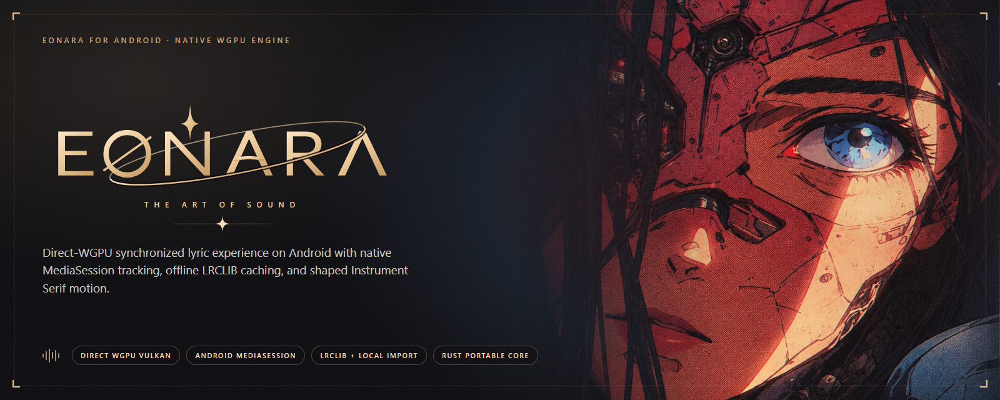
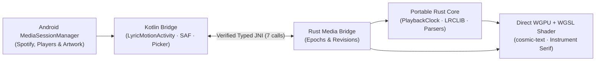

<p align="center">
  
</p>

# Eonara for Android

**The Art of Sound**

**Eonara for Android** (formerly *LyricMotion Android*) is a native Rust & Kotlin synchronized-lyric application powered by a single direct `wgpu` renderer owning the `NativeActivity` surface, with Vulkan / OpenGL ES shaders, `cosmic-text` typography shaping, Android `MediaSession` tracking, and offline-cached LRCLIB / local lyrics support.

No WebView is used; all rendering runs directly through the native GPU pipeline.

---

## Highlights

- **Direct WGPU Renderer (`android-app/`)**: Owns the Android `ANativeWindow` surface cleanly across focus/resume transitions with custom WGSL shaders, touch-reactive light fields, and `cosmic-text` 0.19 + *Instrument Serif* glyph rendering.
- **Native Launch & About Identity**: Shows a brief native *Eonara — The Art of Sound* launch state on startup, provides top-left **Eonara · About** (and **About Eonara** in the player picker) featuring the official poster artwork, and packages adaptive launcher icons across `mdpi`–`xxxhdpi` + Android 13 monochrome.
- **Android MediaSession Bridge**: Observes active players via `MediaSessionManager` (automatic or manual selection via top-right **Players**), transfers track metadata, album art bitmaps, elapsed-realtime playback anchors, and capability-gated transport controls across typed JNI calls.
- **Portable Rust Core (`core/`)**: Monotonic playback clock, standard/enhanced LRC, TTML, plain text, and Lyricsfile 1.0 parsers, plus public LRCLIB lookup with bounded retries, stale-generation suppression, and app-private disk cache.
- **Safe Local Import**: Long-press anywhere on screen to import `.lrc`, `.ttml`, `.yaml`, or `.txt` lyrics directly via Android Storage Access Framework (256 KB bounded read, no broad storage permissions).

---

## Architecture



Detailed module boundaries and verified runtime checks are recorded in [Architecture](docs/ARCHITECTURE.md), [Third-Party Notices](docs/THIRD_PARTY_NOTICES.md), and [Test Report](docs/TEST_REPORT.md).

---

## Prerequisites & Build (ARM64 Debug APK)

Prerequisites: Android SDK Platform 35, Build Tools 36.0.0, NDK `27.2.12479018`, Rust target `aarch64-linux-android`, `cargo-ndk` 4.1.2, and a Gradle-compatible JDK (verified with JDK 24.0.2; Gradle wrapper 9.4.1 / AGP 9.1.0).

Set `JAVA_HOME`, `ANDROID_HOME`, and `ANDROID_NDK_HOME`, then run:

```powershell
$env:RUSTUP_TOOLCHAIN = "stable-x86_64-pc-windows-gnu"
$env:CARGO_BUILD_JOBS = "1"
.\android\gradlew.bat -p android --no-daemon --max-workers=1 assembleNativeDebug
```

The built APK is output at `android\app\build\outputs\apk\debug\app-debug.apk`. Default ABI is `arm64-v8a` (use `-PnativeAbi=x86_64` for x86_64 emulator builds).

Run portable-core tests:

```powershell
$env:RUSTUP_TOOLCHAIN = "stable-x86_64-pc-windows-gnu"
cargo test --workspace
```

Before delivering any APK, verify that all compiled Kotlin `external` methods match exported symbols in `liblyricmotion_android.so`:

```powershell
.\scripts\verify-jni-bindings.ps1 -ApkPath .\android\app\build\outputs\apk\debug\app-debug.apk -Abi arm64-v8a
```

---

## Companion Project

- **[Eonara](https://github.com/Demmonics/Eonara)** — Windows 11 desktop host and Three.js / WebGL2 kinetic typography studio featuring **13 animated styles**, **7 spectral shader modes**, GSMTC media integration, and a click-through transparent desktop overlay.

---

## Upgrade & Package Compatibility

To preserve seamless app upgrades, installed notification-listener permissions, and cached lyrics for existing *LyricMotion Android* users:

- Android application ID and namespace remain `com.lyricmotion.android`.
- Native library name remains `liblyricmotion_android.so` (`lyricmotion_android`).
- `LyricMotionActivity` and `LyricMotionNotificationListener` class/JNI symbols remain preserved.

---

## Privacy, Inspiration & License

- **Privacy**: Active session metadata comes locally from Android `MediaSessionManager` with user-granted Notification Listener access (the listener service itself reads no notification text). Optional LRCLIB queries contact only public `/api/get` with track metadata; no account tokens or telemetry are collected.
- **Inspiration**: Eonara is an independent open-source application inspired by kinetic lyric craft such as *Verci*, written in original Rust, WGSL, and Kotlin.
- **License**: Licensed under the [MIT License](LICENSE), with upstream crates under MIT / Apache-2.0 / ISC / CDLA-Permissive-2.0 and *Instrument Serif* under SIL OFL 1.1. See [Third-Party Notices](docs/THIRD_PARTY_NOTICES.md).
