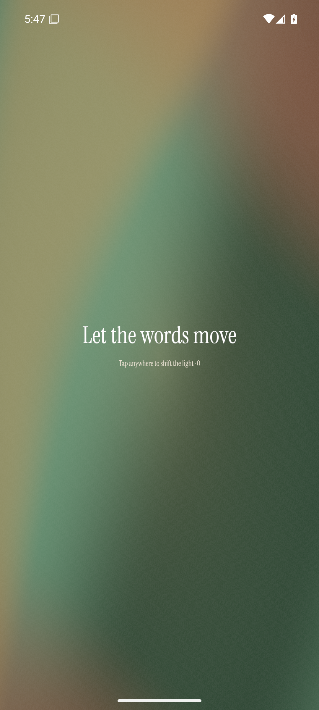
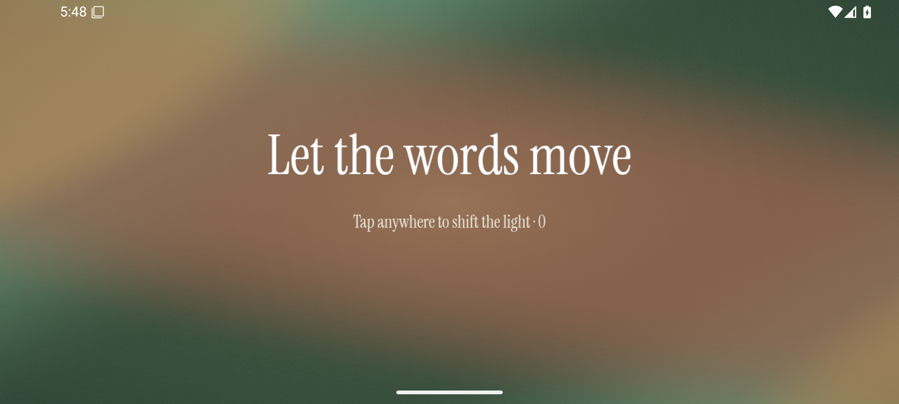
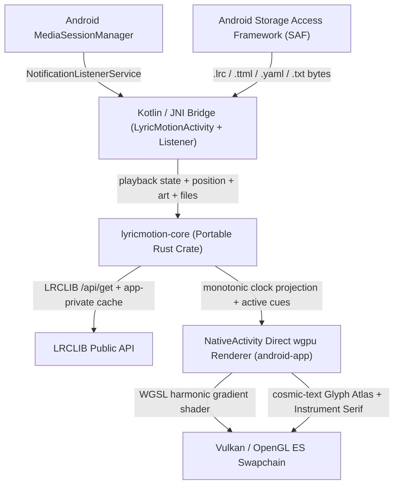

<div align="center">
  <h1>LyricMotion Android</h1>
  <p><strong>Native Rust &amp; direct <code>wgpu</code> kinetic lyrics companion for Android — zero WebView, custom WGSL shaders, and local MediaSession sync.</strong></p>

  <p>
    
    
    
    
    
  </p>

  <p>
    <a href="#visual-proof-m0-emulator">Screenshots</a> ·
    <a href="#why-direct-wgpu-instead-of-gpui-mobile">Why Direct wgpu</a> ·
    <a href="#project-status--verification-gates">Verification Status</a> ·
    <a href="#building-from-source">Build &amp; Install</a> ·
    <a href="https://github.com/Demmonics/LyricMotion">Windows App</a>
  </p>
</div>

---

**LyricMotion Android** brings synchronized lyrics and album-inspired harmonic shader backgrounds to Android using a single native Rust **`wgpu`** surface owner inside **`NativeActivity`**—with **no WebView, no Chromium runtime overhead, and zero browser scripts**.

---

## Visual Proof (M0 Emulator)

<table>
  <tr>
    <td width="38%" align="center">
      <br/>
      <strong>Portrait Native Surface</strong><br/>
      <sub>Custom WGSL shader + <code>cosmic-text</code> Instrument Serif shaping on Vulkan</sub>
    </td>
    <td width="62%" align="center">
      <br/>
      <strong>Landscape Orientation &amp; Surface Resize</strong><br/>
      <sub>Touch-driven light shift counter &amp; flicker-free swapchain reconfiguration</sub>
    </td>
  </tr>
</table>

> *Note: Screenshots above capture the verified **M0** renderer proof on an Android 35 `x86_64` emulator. **M1** media-session and lyrics-lookup code compiles and packages cleanly into the ARM64 &amp; x86_64 debug APKs, and awaits runtime testing on physical hardware or an emulator.*

---

## Architecture



### Why Direct `wgpu` Instead of GPUI Mobile?

During Milestone 0 ([`docs/GPUI_FEASIBILITY.md`](docs/GPUI_FEASIBILITY.md)), we built and audited `gpui-mobile` cleanly on Android. Because its pinned public API does not expose a supported same-renderer custom WGSL shader pass hook, we pivoted cleanly to **direct `wgpu` + `cosmic-text`** owning the single `NativeActivity` surface:

- **One Surface Owner**: Eliminates multi-context contention and surface-loss race conditions across rotation and `onPause` / `onResume`.
- **Full Custom WGSL Control**: Harmonic multi-point shader fields render natively on Vulkan (or GLES fallback) without DOM/CSS compositor overhead.
- **Portable `lyricmotion-core` Engine**: Monotonic playback clock smoothing, seek clamping, standard/enhanced LRC, TTML `<p>`/`<span>` timing, draft Lyricsfile YAML validation, OKLab/palette helpers, and bounded LRCLIB retry/caching live in a standalone host-agnostic crate (`core/`) tested with `cargo test`.

---

## Project Status & Verification Gates

| Milestone / Component | Current Gate | Evidence |
|---|---|---|
| **M0 — Direct `wgpu` Surface, WGSL Shader, Font Shaping, Touch & Lifecycle** | **Verified (Android 35 `x86_64` Emulator)** | Portrait, landscape, touch input counter, and Home/resume lifecycle verified (`docs/screenshots/m0-refined-*.png`); Vulkan backend verified |
| **M1 — `lyricmotion-core` Clock, LRC / TTML / Lyricsfile Parsers & LRCLIB Cache** | **Verified (`cargo test` Unit Suite)** | **33 unit tests passing** covering clock projection, rate/pause bounds, LRC/TTML/Lyricsfile parsing, explicit timing quality tags, cancellation, and disk caching |
| **M1 — Android Packaging & Static Binary Audits (`arm64-v8a` & `x86_64`)** | **Verified (Build & APK Audit)** | Both `lyricmotion-arm64-m1-debug.apk` and `lyricmotion-x86_64-m1-debug.apk` pass v2 signing, zipalign, ABI checks, manifest permission audit, and zero-WebView DEX inspection |
| **M1 — End-to-End MediaSession & Physical ARM64 Runtime** | **Experimental / Runtime-Untested** | M1 APKs are published as a clearly labeled **Pre-release**; live phone notification-access media sync, LRCLIB network calls on-device, and physical ARM64 frame pacing need hardware smoke-testing |

---

## Permissions & Privacy

| Permission / Capability | Purpose | Default State |
|---|---|---|
| `android.permission.INTERNET` | Optional LRCLIB (`/api/get`) timed-lyrics lookup using track title, artist, album, and approximate duration | Used only during active track lookup; zero telemetry or analytics |
| `BIND_NOTIFICATION_LISTENER_SERVICE` (`LyricMotionNotificationListener`) | Reads local active MediaSession metadata, playback timeline, and artwork locally on-device | **Disabled by default** — must be explicitly granted by user in Android **Notification access** settings |
| Storage Access Framework (`ACTION_OPEN_DOCUMENT`) | Import local `.lrc`, `.ttml`, `.yaml`, or `.txt` lyrics files cleanly without broad storage permissions | Invoked only when user picks a file |

---

## Installing the Prebuilt M1 Debug APK

1. Download **`LyricMotion-Android-arm64-debug.apk`** from the [GitHub Releases](../../releases) page (for ARM64 phones) or use `LyricMotion-Android-x86_64-debug.apk` for `x86_64` Android emulators.
2. Verify SHA-256 against `SHA256SUMS.txt` attached to the release.
3. Transfer to your Android device and allow **Install unknown apps** when prompted, or install via ADB:
   ```powershell
   adb install -r LyricMotion-Android-arm64-debug.apk
   ```
4. To enable live player metadata sync once launched, grant **Notification access** to **LyricMotion** in Android **Settings → Notifications → Notification access** (or **Apps → Special app access → Notification access**).

---

## Building from Source

### Prerequisites

- **Rust** stable toolchain with targets: `aarch64-linux-android` (phone) and/or `x86_64-linux-android` (emulator)
- **`cargo-ndk`** (`>= 4.1.2`)
- **Android SDK Platform 35**, **Build Tools 36.0.0**, and **NDK 27.2.12479018** (min API 26)
- **JDK 21–24** (verified locally with JDK 24.0.2; Gradle 9.4.1 / AGP 9.1.0)

### Build & Test Commands

Run unit tests for the portable Rust core crate:

```powershell
cargo test --workspace
```

Build the ARM64 debug APK (`android/app/build/outputs/apk/debug/app-debug.apk`):

```powershell
# On Windows without MSVC linker installed, use the GNU host Rust toolchain for host build scripts:
# $env:RUSTUP_TOOLCHAIN = "stable-x86_64-pc-windows-gnu"
$env:CARGO_BUILD_JOBS = "1"
.ndroid\gradlew.bat -p android --no-daemon --max-workers=1 assembleNativeDebug
```

Build an `x86_64` emulator APK instead:

```powershell
.ndroid\gradlew.bat -p android --no-daemon --max-workers=1 -PnativeAbi=x86_64 assembleNativeDebug
```

### ABI Matrix

| Build Variant | Rust Target | Android ABI Flag | Target Hardware |
|---|---|---|---|
| Default (`arm64-v8a`) | `aarch64-linux-android` | *(default)* | Physical modern Android phones |
| Emulator (`x86_64`) | `x86_64-linux-android` | `-PnativeAbi=x86_64` | Windows/Linux `x86_64` Android emulators |

---

## Documentation Index

- [`docs/ARCHITECTURE.md`](docs/ARCHITECTURE.md) — Surface ownership, render loop, and `lyricmotion-core` crate split
- [`docs/ANDROID_MIGRATION.md`](docs/ANDROID_MIGRATION.md) — Milestone plan and portable subsystem breakdown
- [`docs/GPUI_FEASIBILITY.md`](docs/GPUI_FEASIBILITY.md) — Technical audit explaining the direct `wgpu` choice
- [`docs/MEDIA_INTEGRATION.md`](docs/MEDIA_INTEGRATION.md) — MediaSession listener, Kotlin/JNI bridge, and LRCLIB architecture
- [`docs/OVERLAY_FEASIBILITY.md`](docs/OVERLAY_FEASIBILITY.md) — Android system alert window constraints & research
- [`docs/TEST_REPORT.md`](docs/TEST_REPORT.md) & [`docs/THIRD_PARTY_NOTICES.md`](docs/THIRD_PARTY_NOTICES.md) — Exact M0/M1 test reports and dependency/font notices

---

## Companion Project, License & Credits

- 🖥️ **[LyricMotion (Windows)](https://github.com/Demmonics/LyricMotion)** — Tauri v2 + Three.js + WebGL2 Windows desktop studio and click-through overlay with 13 kinetic lyric styles.
- **License**: Dual-licensed under [`MIT`](LICENSE-MIT) OR [`Apache-2.0`](LICENSE-APACHE) (see [`LICENSE`](LICENSE)). Bundled **Instrument Serif** font is licensed under SIL OFL 1.1 (`android-app/assets/licenses/InstrumentSerif-OFL.txt`).
- **Transparency**: Built cleanly in Rust & Kotlin through iterative AI-assisted engineering; emulator screenshots and APK packaging checks are separated explicitly from unverified on-device M1 runtime behavior.
